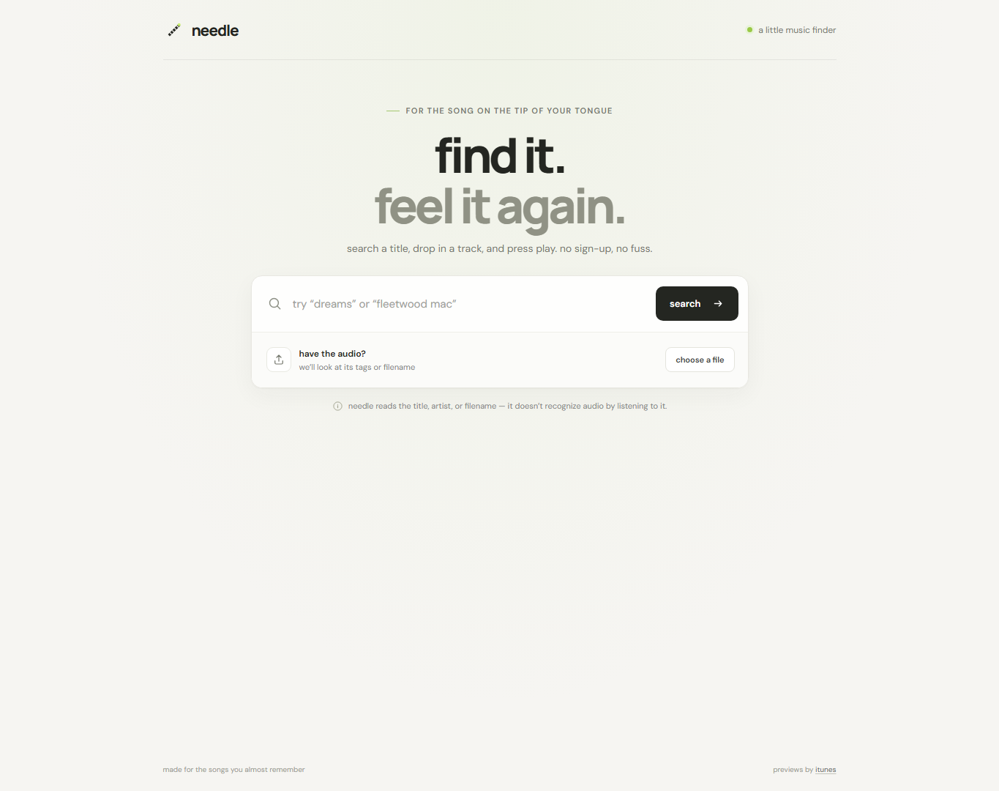

# needle

a tiny music finder for songs you almost remember. search a title or artist, or drop in an audio file to search using its tags or filename. listen to available previews right in the page.



## run it

with node.js installed, start the tiny local server:

```sh
node server.js
```

open [http://localhost:8000](http://localhost:8000).

## how it works

- song searches and short playable previews come from the itunes search api.
- audio files stay in your browser. needle reads embedded title and artist tags with jsmediatags; if those tags are missing or unreadable, it searches with the filename instead.
- needle does not listen to, fingerprint, or recognize the audio itself. it can only search text found in the tags or filename.
- an internet connection is needed for music search, previews, fonts, and the optional tag reader.

## files

- `index.html` — page structure
- `styles.css` — responsive styling
- `app.js` — search, file tags, and preview playback
- `server.js` — dependency-free local preview server
- `screenshots/app.png` — screenshot of the running app
